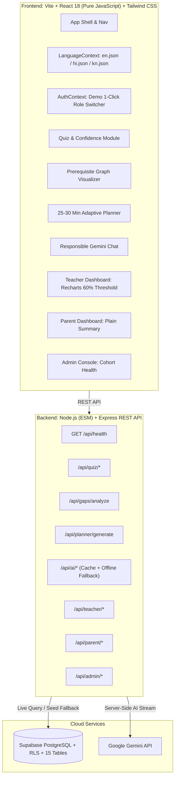

# LearnLens 🎓🔍
> **Smart, Inclusive, Personalized Education for Large Classrooms**  
> *Built for a 24-Hour Hackathon • Clean Pure-JS Architecture • Supabase & Gemini Powered*

---

## 🏆 Executive Summary & Pitch

In modern high-enrollment classrooms (40–60+ students per teacher), exams report **what** a student scored (e.g. *50% on Quadratic Equations*), but fail to answer:
1. **Why** did they struggle? (Is it truly quadratic equations, or an unresolved 8th-grade prerequisite like factoring?)
2. **How** should they study? (Students don't have endless hours; generic advice like "study more" causes burnout.)
3. **Who** is keeping track? (Teachers lack class-wide prerequisite bottleneck heatmaps; parents receive impenetrable technical marks cards.)

**LearnLens solves all three with five core pillars:**
- 🔍 **Root-Cause Prerequisite Gap Finder**: Traverses the Class 9 Mathematics curriculum Directed Acyclic Graph (DAG) to find the foundational ancestor concept holding the student back.
- 🎯 **Confidence-Weighted Diagnostics**: Students tag every answer as *Sure*, *Not Sure*, or *Guessing*. Correct guesses are down-weighted ($0.5\times$) because guessing isn't genuine mastery.
- ⏱️ **Adaptive Free-Hour Study Planner**: Dynamically converts available study hours and target exam dates into strict, science-backed **25–30 minute focused sessions**, scheduling root prerequisites chronologically first.
- 🤖 **Responsible Gemini AI Tutor**: Provides step-by-step misconception coaching with server-side caching, strict offline curriculum fallbacks, bad-question reporting, and mandatory AI-verification tags.
- 🌐 **Four Unified Dashboards with Tri-Lingual Support**: One unified PostgreSQL (Supabase) schema serves **Students, Teachers, Parents, and Administrators** in **English, Hindi (हिंदी), and Kannada (ಕನ್ನಡ)** with zero hardcoded UI strings.

---

## ⏱️ 3-Minute Hackathon Demo Script

Follow this script during live jury evaluation:

| Timestamp | Screen | Narrative & Live Action |
| :--- | :--- | :--- |
| **0:00 - 0:30** | Landing Page (`/`) | *"Welcome to LearnLens. Today, when a 9th-grader fails quadratic equations, teachers assign more quadratic equations. But 66% of the time, the student actually failed because they never mastered 8th-grade algebraic factoring. Watch how LearnLens solves this."* Toggle the header language switch between **English**, **हिंदी**, and **ಕನ್ನಡ**. |
| **0:30 - 1:15** | Student Diagnostic Quiz (`/quiz`) | Sign in as **Priya Sharma**. Answer questions across topics. On Question 4 (Quadratics), pick an answer and deliberately select **"Guessing"**. Submit the quiz. Show the results page: 50% score, but notice the button: *"Analyze Learning Gaps & Root Prerequisites"*. |
| **1:15 - 1:50** | Gap Finder & Study Planner (`/gaps` & `/planner`) | Click to view the interactive prerequisite DAG. Show how Priya's failure in Quadratic Equations is visually traced down to **Algebraic Factoring & Middle-Term Splitting**. Click *"Generate Study Plan"*. Plug in free hours (e.g., 5:00 PM). LearnLens schedules **Session 1: Middle-Term Splitting (30m)** *before* touching Quadratics! |
| **1:50 - 2:20** | AI Tutor & Teacher Portal (`/ai-tutor` & `/teacher`) | Ask the AI tutor to explain why $(x-2)(x-3) = 0$ requires splitting middle terms. Show the safety disclaimer and offline fallback badge. Now switch user to **Mr. Rajesh Rao (Teacher)**. Show the Recharts Class 9-A topic accuracy chart with the 60% mastery threshold line, the class bottleneck alert, and click *"Leave Feedback"* to send a note directly to Priya and her mother. |
| **2:20 - 3:00** | Parent & Admin Consoles (`/parent` & `/admin`) | Switch to **Sunita Sharma (Parent)**: show the jargon-free plain-language explanation and Priya's 3-session schedule. Switch to **Principal (Admin)**: highlight school-wide cohort health and the cross-school curriculum bottleneck matrix. |

---

## 🏗️ System Architecture



---

## 🧠 Core Deterministic Algorithms (Pure JavaScript)

Both core engines run 100% deterministically in pure JavaScript without external AI dependencies, guaranteed by automated test suites in `backend/tests/`:

### 1. Confidence-Weighted Prerequisite Gap Finder
- **Confidence Weighting**:
  $$\text{Effective Weight} = \begin{cases} 1.0 & \text{if Sure} \\ 0.75 & \text{if Not Sure} \\ 0.5 & \text{if Guessing} \end{cases}$$
- **Threshold Rule**: Any topic with accuracy $< 60\%$ is flagged as weak.
- **DAG Traversal**:
  When a topic is flagged as weak, the engine walks backwards along its prerequisite dependencies. It identifies the **earliest ancestor concept** with low mastery and marks it as the *Root Prerequisite Bottleneck*.

### 2. Adaptive 25–30 Minute Study Planner
- **Session Duration Invariant**: Every session is strictly sized between **25 and 30 minutes** (aligned with Pomodoro and cognitive load research for adolescent learners).
- **Chronological Prerequisite Invariant**: Prerequisite topics are *always* scheduled on earlier dates/times than downstream topics.
- **Urgency Accelerator**: Closer exam deadlines automatically compress sessions into available free-hour slots.

---

## 🗄️ Database Architecture (Supabase / PostgreSQL)

15 normalized tables with Row Level Security (RLS) policies:
1. `profiles`: User identity, roles (`student`, `teacher`, `parent`, `admin`), avatars, and grades.
2. `parent_student_links`: Secure linkage between parents and their children.
3. `classes` & `class_enrollments`: Class groupings and cohort rosters.
4. `topics` & `topic_prerequisites`: Curriculum Directed Acyclic Graph (DAG).
5. `questions` & `question_options`: Diagnostic item bank with multi-lingual questions.
6. `diagnostic_attempts` & `attempt_answers`: Student answers stored with confidence ratings.
7. `learning_gaps`: Diagnosed root-cause prerequisite gaps with evidence strings.
8. `study_plans` & `study_sessions`: 25–30 minute scheduled sessions.
9. `teacher_feedback`: Direct teacher guidance to students and parents.
10. `ai_reports`: Flagged question reports for continuous safety audits.

---

## 🌐 Tri-Lingual Support (EN / HI / KN)

LearnLens features **zero hardcoded visible UI strings**. Every button, heading, tooltip, and explanation dynamically resolves through `LanguageContext`:
- `frontend/src/translations/en.json`: English
- `frontend/src/translations/hi.json`: Hindi (हिंदी)
- `frontend/src/translations/kn.json`: Kannada (ಕನ್ನಡ)

Users can toggle languages on any screen instantaneously via the top navigation bar.

---

## 🛡️ Responsible AI & Offline Fallback

1. **Server-Side Exclusivity**: The Gemini API key is never exposed to the client bundle.
2. **Deterministic Fallbacks**: If the Gemini API is unreachable, has quota limits, or is offline, LearnLens automatically serves curated, textbook-aligned pedagogical explanations.
3. **Mandatory Verification Notice**: Every AI response includes a visible `⚠️ AI-generated, please verify with your textbook.` notice.
4. **Student Feedback Loop**: Students can click *"Flag this Question/Answer"* to report inaccuracies to administrators.

---

## 🚀 Quickstart & Local Installation

### Prerequisites
- Node.js (v18+ or v20+)
- npm
- Git

### 1. Setup Environment
```cmd
cd "C:\Users\Mohitha G S\.gemini\antigravity\scratch\learnlens"
```
Copy environment templates:
- `backend/.env` containing `PORT=5000`, `SUPABASE_URL`, `SUPABASE_ANON_KEY`, `GEMINI_API_KEY`.
- `frontend/.env` containing `VITE_SUPABASE_URL`, `VITE_SUPABASE_ANON_KEY`.

### 2. Run Backend
```cmd
cd backend
npm install
npm run dev
```
Backend runs on `http://localhost:5000`. Test health: `http://localhost:5000/api/health`.

### 3. Run Frontend
```cmd
cd frontend
npm install
npm run dev
```
Open `http://localhost:5173` (or the indicated port) in your web browser.

### 4. Run Unit Tests
```cmd
cd backend
npm test
```
All 10 unit tests for Gap Finder and Study Planner will execute and pass.

---

## 👥 Hackathon Team Roles & Demo Accounts

| Role | Demo Name | Credentials | Key Features |
| :--- | :--- | :--- | :--- |
| **Student** | Priya Sharma | 1-Click Login | Diagnostic quiz, confidence rating, prerequisite gap tree, free-time study plan, AI tutor |
| **Teacher** | Mr. Rajesh Rao | 1-Click Login | Class 9-A topic accuracy chart (60% threshold), prerequisite bottleneck alert, student roster, leave feedback |
| **Parent** | Sunita Sharma | 1-Click Login | Jargon-free child performance summary, 25-30 min study schedule, teacher notes, acknowledgment reply |
| **Admin** | Dr. K.S. Sharma | 1-Click Login | School KPIs, curriculum health matrix, create cohort modal, student-parent roster linking |

---

*Built with ❤️ for inclusive, smart education that leaves no student behind.*
