# LearnLens 🎓🔍
> **Smart, Inclusive, Personalized Education for Real Classrooms**  
> *Production-Ready Single-Server Setup • Server-Graded Diagnostics • Multi-Level Cognitive Ranks • Teacher Clarification Workflow*

---

## 🌟 Overview: Real Education App Flow

LearnLens is a full-stack educational diagnostic and guidance platform running on a single Express/React server. It bridges the gap between raw test scores and personalized learning intervention:

```mermaid
flowchart LR
    A["Admin Onboards Cohort<br/>(Single or CSV Upload)"] --> B["Temporary Passwords<br/>(Forced First-Login Change)"]
    B --> C["Student Takes Diagnostic<br/>(L1=1m, L2=2m, L3=3m)"]
    C --> D["Server Evaluates Quiz<br/>(Grades, Level, Weak Topics)"]
    D --> E["Automatic Report & Rank<br/>(Ties Share Rank, Exclude Demo)"]
    E --> F["Teacher Queue & Review<br/>(Needs Help / Focus / Doing Well)"]
    F --> G["Student & Parent Dashboards<br/>(Live Rank & Teacher Note)"]
    G --> H["Adaptive Study Planner<br/>(Teacher-Prioritized 25m Sessions)"]
```



1. **Admin creates real accounts**: Add individual people or batch-import up to 500 users at once via CSV with instant row-by-row pre-validation and downloadable templates.
2. **Secure temporary credentials**: The server generates random temporary passwords (`Lens#XXXXXX`). Every new user has `must_change_password = true` and is forced to set a permanent password at first login.
3. **Server-side quiz grading**: Browser scores are never trusted. The server verifies each answer against authoritative answer keys:
   - **Level 1** = 1 mark
   - **Level 2** = 2 marks
   - **Level 3** = 3 marks
   - Wrong or skipped = 0 marks (no negative marking; confidence weighting is recorded for metacognitive analysis without lowering raw score).
   - Atomic database write with unique constraints prevents duplicate attempt submissions.
4. **Real competition rankings**: Cumulative percentage across all completed attempts. Uses SQL competition `RANK()` where ties share a rank (e.g. 1, 1, 3). Demo accounts (`is_demo = true`) are strictly excluded from real ranks.
5. **Teacher review and clarification**: Incoming reports appear automatically in the assigned teacher's queue with a "New" badge (polled every 15 seconds). Teachers review reports and submit a clarification:
   - Status: **Needs extra help**, **Improve focus**, or **Doing well**
   - Topic tags selected from weak areas
   - Guidance comment (max 500 characters)
6. **Student and Parent visibility**:
   - Students see their live class rank, school rank, and their teacher's latest guidance note.
   - Parents see their child's live rank, jargon-free academic progress, and teacher notes with one-click acknowledgment.
   - Strict Row-Level Security (RLS): students never see other students' data; parents only see their linked children; teachers only see assigned classes.
7. **Study Planner feed**: The teacher's clarified topics feed directly into the student's adaptive study planner as high-priority sessions scheduled before unguided topics.
8. **Admin monitoring**: Single-page monitoring console showing real totals (students, teachers, parents, classes, reports submitted, pending reviews), full user directory, school-wide reports and ranks table, and audit activity stream.

---

## 🚀 Quick Start (Unified Single Server)

LearnLens runs on **one single server** serving both the REST API routes (`/api/*`) and the compiled React production frontend from **`http://localhost:5000`**.

### 1. Prerequisites
- **Node.js** (v18+ or v20+)
- **npm** (v9+)

### 2. Build Frontend Distribution
From the repository root:
```bash
# Compiles React frontend to frontend/dist
npm run build
```

### 3. Start the Server
```bash
# Starts Express server on port 5000 serving both API and static UI
npm start
```

### 4. Access the Application
Open your browser at: **[http://localhost:5000](http://localhost:5000)**

---

## 📥 How to Add Real Data

### 1. Adding Users One by One
1. Log in as Administrator (`admin@learnlens.edu` / `Admin#12345`).
2. In the **Add Individual Person** form:
   - Choose Role: **Student**, **Teacher**, **Parent**, or **Admin**.
   - Enter Full Name and Email Address.
   - Assign Class (for students), Teaching Class (for teachers), or Linked Student (for parents).
3. Click **Generate Account & Password**.
4. The server generates a random temporary password (`Lens#XXXXXX`). Copy it or hand it to the user.

### 2. Batch-Adding Users via CSV
1. In the Admin Console under **Batch CSV Onboarding**, click **Template** to download `learnlens_users_template.csv`.
2. CSV format specifications:
   ```csv
   role,full_name,email,class_name,linked_student_email
   student,Kavya Nair,kavya.nair@school.edu,Class 10-A,
   student,Rohan Gupta,rohan.gupta@school.edu,Class 10-A,
   teacher,Mr. Vikram Sarabhai,vikram.sarabhai@school.edu,Class 10-A,
   parent,Suresh Nair,suresh.nair@school.edu,,kavya.nair@school.edu
   ```
3. Upload your CSV file (up to 500 rows).
4. The server runs an instant row-by-row pre-validation preview displaying valid rows and highlighting specific row errors (duplicate emails, invalid role, unknown class, missing child).
5. Click **Import Valid Accounts**. All valid users are created with random temporary passwords.
6. Click **Download Passwords CSV** to save all generated credentials for distribution.

### 3. First Login & Password Change Flow
1. The new user navigates to `http://localhost:5000/login` and enters their email and temporary password.
2. The server recognizes `must_change_password = true` and prompts the user with the forced **Permanent Password Change** dialog.
3. Once set, `must_change_password` becomes `false` and subsequent logins use the permanent password.

---

## ⚙️ Environment Variables & Configuration

Create or edit `.env` in the project root:

```env
# Server Port
PORT=5000
NODE_ENV=production

# Demo Mode Toggle
# Set DEMO_MODE=false in production to hide demo buttons and exclude demo accounts from lists
DEMO_MODE=true

# Supabase PostgreSQL (Optional - backend runs pure JS fallbacks if offline)
SUPABASE_URL=https://your-project-id.supabase.co
SUPABASE_KEY=your-supabase-anon-key
SUPABASE_SERVICE_ROLE_KEY=your-supabase-service-role-key

# Google Gemini AI (Optional - uses textbook fallbacks if unconfigured)
GEMINI_API_KEY=your-gemini-api-key
GEMINI_MODEL=gemini-2.5-flash
```

---

## 🧪 Automated Test Battery

The project includes thorough deterministic test suites verifying every layer of the application:

```bash
# 1. Run Complete End-to-End Real Cohort Verification (Step 8)
node backend/tests/step8_e2e.test.js

# 2. Run All Step Test Suites (Step 2 through Step 8)
node backend/tests/step8_e2e.test.js ; node backend/tests/step7.test.js ; node backend/tests/step6.test.js ; node backend/tests/step5.test.js ; node backend/tests/step4.test.js ; node backend/tests/step3.test.js ; node backend/tests/step2.test.js

# 3. Or run default npm test
npm test
```

### What the Test Suites Verify:
- **Step 2 (`step2.test.js`)**: Single user creation, CSV preview validation (duplicate/format checks), temporary passwords, forced password change, and password reset.
- **Step 3 (`step3.test.js`)**: Server-side level grading (L1=1m, L2=2m, L3=3m), duplicate submission protection (409 Conflict), cognitive prerequisite gap analysis.
- **Step 4 (`step4.test.js`)**: Competition `RANK()` algorithm, ties sharing ranks, demo accounts excluded from ranks, student privacy (403 Forbidden for cross-student access).
- **Step 5 (`step5.test.js`)**: Teacher incoming reports feed, student roster with overall % and class rank, teacher clarifications with status, topics, and comment validation.
- **Step 6 (`step6.test.js`)**: Student & Parent dashboard teacher note displays, parent linked-child rank view, study planner feed with teacher priority sessions.
- **Step 7 (`step7.test.js`)**: Admin monitoring real totals, user directory with role and status filters, school-wide reports and ranks table, and audit activity stream.
- **Step 8 (`step8_e2e.test.js`)**: Complete multi-role simulation with a real cohort (teacher, students, parent) testing onboarding -> temporary password -> forced change -> quiz grading -> automatic report -> teacher review & clarification -> student/parent dashboard update -> study planner prioritization -> admin monitoring.

---

## 🛡️ Privacy & Access Control (Row-Level Security)

| Role | Access Permissions | Restricted / Blocked |
| :--- | :--- | :--- |
| **Student** | Own quiz attempts, own score, own class/school rank, own teacher guidance note, adaptive study planner. | Strictly blocked (403) from seeing other students' ranks, scores, notes, or class leaderboards. |
| **Parent** | Linked children's progress, live ranks, plain-language summaries, teacher feedback, study schedule. | Strictly blocked (403) from viewing unlinked students' scores, reports, or ranks. |
| **Teacher** | Assigned class rosters, class averages, incoming reports feed (15s auto-poll), report review & clarification. | Strictly blocked (403) from writing notes or viewing reports for unassigned classes. |
| **Admin** | Full control on one page: create/edit users, reset passwords, batch CSV onboarding, assign classes, school-wide reports & rankings table, activity audit log. | Kept strictly on a single admin console with no student/teacher Home navigation. |

---

## 👥 Default Accounts

| Role | Name | Email | Default Password | Notes |
| :--- | :--- | :--- | :--- | :--- |
| **Admin** | School Administrator | `admin@learnlens.edu` | `Admin#12345` | Single-page console with complete school controls |
| **Teacher** | Mr. Rajesh Rao | `rajesh.rao@learnlens.edu` | `Admin#12345` | Teacher for Class 11-A |
| **Student** | Priya Sharma | `priya.sharma@learnlens.edu` | `Admin#12345` | Class 11-A Student |
| **Student** | Ananya Sen | `ananya.sen@learnlens.edu` | `Admin#12345` | Class 11-A Real Student |
| **Parent** | Sunita Sharma | `sunita.sharma@learnlens.edu` | `Admin#12345` | Parent linked to Priya Sharma & Arjun Sharma |

*(New users created by the admin receive temporary passwords generated by the server and are forced to change their password on first login.)*

---

*Built with ❤️ for inclusive, high-integrity education.*
